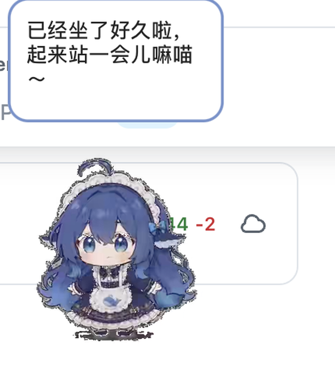

<div align="center">

# LuckyPet

**macOS 原生桌宠 + 定时久坐提醒**

Swift / AppKit 实现 · 无 Python 运行时 · 106 段透明动画 · 全程本地运行、不联网



</div>

---

## 这是什么

一只常驻桌面的小女仆，到点会喊你起来活动。

和常见的桌宠实现不同，本项目**不是**打包 Electron 或 Python 运行时，而是用 Swift + AppKit
直接写成原生 `.app`：透明无边框窗口、AVFoundation 硬件解码带 Alpha 通道的 HEVC 动画、
自绘气泡、菜单栏常驻。动画预处理在构建时完成，运行应用无需 Python、超分模型或联网。

提醒功能是本项目相对原版桌宠的主要增补：固定间隔循环、可编辑文案池、
午休/夜间免打扰、临时暂停、今日计数。

## 功能

**提醒**

- 固定间隔循环，默认 **45 分钟**，可调 1–240 分钟（另有 25 / 45 / 60 / 90 快捷按钮）
- 提醒文案池，每行一条，每次随机显示一条，可自行增删
- 免打扰时段：午休 + 夜间，各自独立开关与起止时间
- 临时暂停 15 / 30 / 60 / 120 分钟，或「本轮重新计时」
- 触发时：桌宠放大并移动到当前屏幕中央，同时播放一段随机动作；动作播放完毕后回到原位，头顶气泡默认显示 25 秒，并可同时发送系统通知和提示音
- 菜单栏实时显示「下次提醒 X:XX 后」「今日已提醒 N 次」

**桌宠**

| 操作 | 效果 |
|---|---|
| 单击 | 摸头：回应动画 + 随机傲娇台词 |
| 按住拖动 | 拎起来，窗口跟随鼠标 |
| 快速甩动后松手 | 抛物线飞出，撞屏幕边缘反弹，落地恢复待机 |
| 拖到屏幕四边后松手 | 可把角色放在屏幕边缘或角落，持续显示，不自动吸入隐藏 |
| 右键 | 摸头 / 立即提醒 / 暂停 30 分钟 / 设置 / 隐藏 / 退出 |
| 空闲 22–45 秒 | 随机表演一段动作（89 段素材） |
| 菜单栏图标 | 提醒状态、设置、大小、置顶、退出 |

## 系统要求

- macOS 13 或更高
- Apple Silicon（arm64）**已实机验证**；Intel 未验证，理论上可自行编译
- 系统通知需手动授权（首次启动会弹窗）

## 安装

### 方式一：下载打包好的应用

2K 素材使包体达到 **2.42 GiB**，超过 GitHub 单文件 2 GiB 上限，因此 `v1.2.0` 的发布包切成两个分卷：

| 文件 | 大小 |
|---|---|
| `LuckyPet-1.2.0-arm64.zip.001` | 1.86 GiB |
| `LuckyPet-1.2.0-arm64.zip.002` | 594 MiB |

把两个文件下载到同一目录，在终端合并后解压：

```bash
cat LuckyPet-1.2.0-arm64.zip.001 LuckyPet-1.2.0-arm64.zip.002 > LuckyPet.zip
unzip LuckyPet.zip
```

合并后的完整包 SHA-256（可选核对）：

```text
d039c2c68ee03ebc5f7a0ca90c34e00100dd943fdf973e99f6397d68362eb689
```

把解压出的 `LuckyPet.app` 拖到「应用程序」文件夹。

首次打开需 **右键 → 打开**（本项目使用 ad-hoc 签名，未做 Apple 公证）。

### 方式二：从源码构建

需要 Xcode 命令行工具（Swift 6+）、ffmpeg，以及仅用于素材处理的 Python 3.12 环境。
本修复版使用原始透明通道和 Real-ESRGAN 动画模型，统一输出 2560×1440 HEVC with Alpha。

```bash
# 所有依赖、缓存和模型都放在当前项目
UV_CACHE_DIR="$PWD/.cache/uv" uv venv --python 3.12 .venv
UV_CACHE_DIR="$PWD/.cache/uv" uv pip install --python .venv/bin/python -r requirements-hd.txt

# 固定上游版本并逐文件校验，避免素材在重建时漂移
python3 scripts/fetch_assets.py
python3 scripts/download_model.py

# 保留 VP9 原始透明通道、去白底污染、稳定边缘并对完整动画做 4× 超分
.venv/bin/python scripts/animation_hd.py --device mps --workers 2

# 构建可直接运行的原生应用
./build.sh
```

产物：`dist/LuckyPet.app`。模型、Python 环境和原始素材不会打进应用。
`Assets/hd_manifest.json` 记录源文件/成品哈希、分辨率、帧率、帧数及模型版本，重跑会校验后续传。

完整的高清重建说明——断点续跑、实测耗时、CPU/MPS 差异与常见问题——见
[docs/UPSCALE.md](docs/UPSCALE.md)。

## 本次画质与窗口修复

原始动画为 **640×360 VP9 with Alpha**，并非无透明通道的黑底素材。旧管线以 FFmpeg 默认 VP9
解码器读取 RGB，实际丢弃了独立 alpha 位流，再把错误的 RGB 当成黑底重新抠图。背景残色
因此变成亮色碎边，随动画变化而闪烁。

修复后的素材管线：

1. 指定 `libvpx-vp9` 解码，保留源 alpha。
2. 按源 alpha 反解混入的白底颜色，仅对不稳定的低 alpha 亮边借用邻近角色颜色，保留不透明的白色蕾丝与图案。
3. 清除极低 alpha 背景底板，做亚像素轮廓收缩和运动补偿的透明度稳定。
4. 使用 Real-ESRGAN `realesr-animevideov3` 提升连续动画细节，输出 **2560×1440**，保持源帧率和帧数。
5. 以 HEVC Alpha 最高可用透明度质量档编码，并通过 macOS 原生解码复查。

模型会重建低分辨率素材的细节，结果不等同于获得原始高精度模型。角色设计、动作和动画时长保持一致。

显示窗口容纳完整 **640×360 逻辑画布**，上方预留 **280pt** 的透明气泡空间。默认 70% 大小下，
窗口为 **448×532pt**。气泡根据角色轮廓定位在头顶上方 **10pt**，并按完整文本自动计算高度；
缩放及提醒放大动画中同步重排，避免卡片或首末行文字被窗口裁掉。小尺寸桌宠也尽量保留 260pt
的可读气泡宽度，靠近屏缘时按实际可见宽度调整。角色逻辑显示尺寸不因
素材超分而改变；摆尾、跳跃、道具和特效在原始画布中的内容都能显示。缩放和屏幕切换时
会保证角色轮廓留在屏幕可见区域内；拖动过程中允许跨越多屏，也可把角色放到屏幕边缘和角落，
画布中的透明留白不限制放置位置。靠近四周不会自动吸附隐藏，提醒气泡会调整自身位置保持可见，
气泡结束后桌宠仍留在原位。透明区域通过当前视频帧
alpha 做鼠标穿透，避免扩大画布后挡住桌面。动作结束回待机时使用双视频层预解码首帧并短暂交叉淡化，
避免切换 AVPlayerItem 时露出透明空帧。视频层随屏幕更新 Retina 像素密度，循环播放使用 `AVPlayerLooper`。

`inspection/comparison-encoded.png` 与 `inspection/comparison-motion.mp4` 对比的是旧、新 HEVC
动画经 macOS 解码后的画面。`inspection/render-smoke/render-smoke.json` 记录原生应用实际渲染、
WindowServer 窗口尺寸、缩放、循环、动作切换和靠边显示检查，并覆盖单条长提醒在 25%–95% 大小、
提醒居中放大、重复提醒及回到原位时的完整显示。气泡预览保存在同一目录，复用当时的视频帧与
实际气泡图层，不截取桌面。

旧 `transcode.py` / `upscale_hd.py` 只保留为历史参考，不再用于构建。`rematte.py` 转发至新管线。

## 配置

配置文件：`~/Library/Application Support/LuckyPet/config.json`

可以直接编辑，也可以在设置窗口修改（改完即时生效并写回）。主要字段：

| 字段 | 默认 | 说明 |
|---|---|---|
| `intervalMinutes` | 45 | 提醒间隔（分钟） |
| `reminderMessages` | 6 条 | 提醒文案池 |
| `breakSeconds` | 25 | 气泡停留秒数 |
| `quietHoursEnabled` / `quietStart` / `quietEnd` | 开 / 12:00 / 13:30 | 午休免打扰 |
| `nightSilenceEnabled` / `nightStart` / `nightEnd` | 开 / 23:00 / 08:00 | 夜间免打扰 |
| `petScale` | 0.70 | 桌宠大小 |
| `alwaysOnTop` | true | 始终置顶 |
| `randomActionsEnabled` | true | 空闲随机动作 |

## 项目结构

```
LuckyPet/
├── src/                      Swift 源码（约 1500 行）
│   ├── main.swift            入口
│   ├── AppDelegate.swift     生命周期、菜单栏、右键菜单、通知、提醒投递
│   ├── PetWindow.swift       透明置顶窗口、动画调度、拖拽与抛掷物理、气泡
│   ├── PetVideoView.swift    AVPlayerLooper 视频层、Retina 像素密度、逐帧 alpha 穿透
│   ├── BubbleOverlay.swift   气泡视图（CALayer 卡片 + Core Text 文字）
│   ├── ClipLibrary.swift     素材索引
│   ├── ReminderEngine.swift  提醒引擎
│   ├── SettingsWindow.swift  设置窗口（纯 AppKit）
│   └── Preferences.swift     配置模型与持久化
├── scripts/
│   ├── fetch_assets.py       从上游下载素材（MIT）
│   ├── animation_hd.py       当前管线：保留原 alpha → 反解白底污染 → Real-ESRGAN → HEVC Alpha
│   ├── download_model.py     下载 Real-ESRGAN 动画模型（不随应用分发）
│   ├── download_torch.py     下载与本机匹配的 PyTorch 轮子
│   ├── install_tools.py      安装项目内工具链
│   ├── verify_assets.py      素材哈希 / 分辨率 / 帧数校验
│   ├── quality_check.py      边缘色差与 alpha 质量检查
│   ├── run_render_test.py    原生渲染自检（窗口尺寸、循环、交互）
│   ├── rematte.py            旧入口，转发至 animation_hd.py
│   ├── transcode.py          历史管线：colorkey 抠图（保留兼容）
│   ├── upscale_hd.py         历史管线：2× 超采样（保留兼容）
│   └── assets_manifest.json  素材清单（109 个文件）
├── icon_work/gen_icon.swift  应用图标生成脚本
├── docs/UPSCALE.md           从旧素材本地重建 2K 的操作说明
├── build.sh                  一键构建
├── Info.plist
├── LICENSE                   MIT（仅覆盖源代码）
└── NOTICE.md                 ★ 素材与角色形象的来源和许可说明
```

## 实现要点

几个在 macOS 上踩过的坑，记录在此以免后来者重复：

1. **`contentView.wantsLayer = true` 会让子视图/子图层的合成失效**
   表现为子视图 `draw` 正常调用、frame 正确、`isVisible == true`，但屏幕上什么都不显示；
   而直接设置 `contentView.layer.backgroundColor` 却能看见。
   → 解决：contentView 不启用图层，视频层与气泡各自 layer-backed。

2. **borderless 窗口动态 `setFrame` 不会提交到 WindowServer**
   `NSWindow.frame` 已是 313，`CGWindowListCopyWindowInfo` 仍报 217。
   → 解决：顶部常驻预留 280pt 气泡空间，不随气泡的显示和隐藏改变窗口尺寸；
   提醒放大与缩小时同步重算文字布局，并核对 WindowServer 的实际窗口尺寸。

3. **独立透明气泡窗口在 `LSUIElement` 应用下不上屏**
   `windowNumber` 有效、`CGWindowList` 查不到；试过 `canBecomeKey`、`NSPanel`、
   `becomesKeyOnlyIfNeeded` 均无效。
   → 解决：气泡内嵌主窗口，不做第二个窗口。

4. **LSUIElement 应用未激活时 Core Animation 淡入不推进**
   `alphaValue` 停在 0 → 不要用 `NSAnimationContext` 做首次显示。

5. **SwiftUI 的宏在命令行 `swiftc` 下不可用**（`swift-plugin-server` 报 malformed response）
   → 设置窗口用纯 AppKit 实现，避免依赖宏插件。

## 许可与来源

**本仓库的源代码**采用 [MIT 许可](LICENSE)。

**动画素材不是本项目的原创**，来自开源项目
[MerZlin/dsh-pet-indesktop](https://github.com/MerZlin/dsh-pet-indesktop)（MIT，Copyright (c) 2026 Merzlin），
其素材又可追溯至 [PC2005-cloud/dsh-pet](https://github.com/PC2005-cloud/dsh-pet) 与
[zhiyou-conder/deepseek-pet](https://github.com/zhiyou-conder/deepseek-pet)（Unlicense）。

**角色形象「DeepSeek 娘」源自百度贴吧社区创作**，不是 DeepSeek 官方形象，
本项目与深度求索公司无任何关联。详见 [NOTICE.md](NOTICE.md)。

分发本项目（含二进制包）时请一并保留 `NOTICE.md`——MIT 许可要求保留版权声明。

## 免责

这是一个技术演示与个人自用项目。角色形象的权利归原作者所有；若相关权利人认为
使用方式不妥，请提 Issue，会立即移除相关内容。
